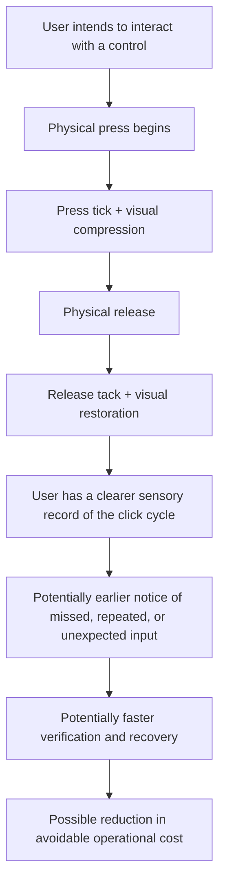
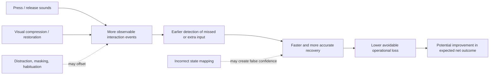
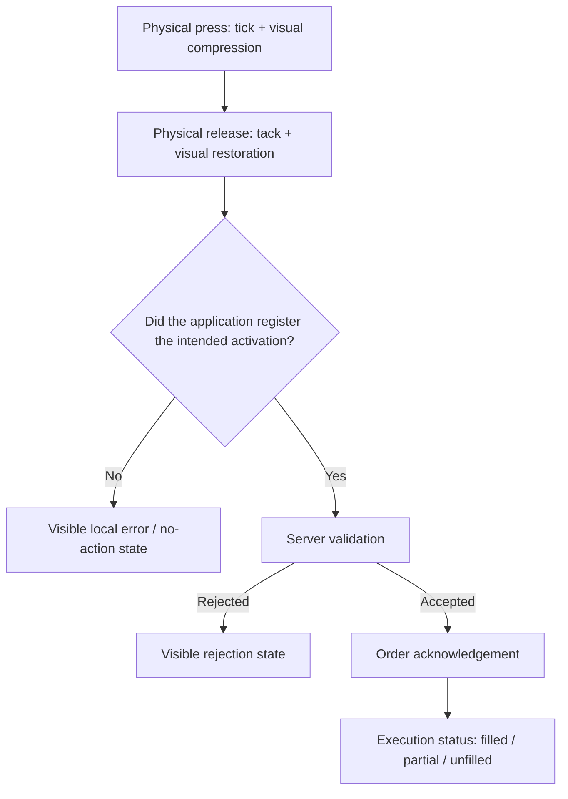

# Auditory–Visual Interaction Feedback as a Human-Performance Intervention in Trading Interfaces

## A research-based assessment of press/release sound, visual button dynamics, error awareness, and potential financial value

**Research memorandum**  
**Prepared:** 27 November 2026  
**Subject:** AstroCrown's short mechanical press/release sounds and accompanying visual press animation  
**Evidence standard:** Peer-reviewed human–computer interaction, human-factors, cognitive psychology, psychoacoustics, and financial-trading research

---

## Abstract

A small interface event can have consequences disproportionate to its visual size. AstroCrown is an information-rich market-discovery environment in which users may inspect market information while simultaneously operating navigation, discovery, and filtering controls. The press/release sound and visual dynamics were selected to make those physical interactions more perceptible without requiring the user to look back at every control. If the interface reports a click only through a local visual state change, the user may not notice whether the intended press–release sequence was completed. This is a recognised class of human–computer interaction problem: action slips can occur when routine actions become automatic and their feedback is not monitored closely.

This memorandum explains why AstroCrown selected a coordinated combination of **a short sound on press, a distinct short sound on release, and visual hover/press/release dynamics**, then evaluates whether that combination could improve users' awareness of interaction events and, through improved error detection and recovery, potentially protect or improve their financial outcomes. The product rationale is that visual movement locates the state change while sound supplies a time-linked cue; the combination is intended to support market-information use without becoming a distracting alert system.

The evidence is promising, but its boundaries are important. The closest controlled study, Brewster, Wright, Dix, and Edwards (1995), compared **auditory buttons with visually highlighted buttons**; it did not test the modern combination of sound plus visual animation. In a small repeated-measures experiment with experienced interface users, the auditory condition produced significantly faster recovery from slip-off errors and fewer corrective clicks. Yet the initial slip-off count was not significantly lower, and the number of codes completed did not increase. This is evidence for improved error recovery, not proof of fewer errors or greater throughput. The 1998 follow-on article develops the broader design principles.

Separate financial-trading studies show that slips/lapses, human–computer interface problems, and situation-awareness failures are recurring contributors to operational incidents and near misses. Multiple-resource theory explains why an auditory cue may complement visual information when users are visually occupied. Multisensory research supplies additional theoretical support for redundant auditory–visual cues, while also warning that combined feedback can sometimes mislead users if it represents the wrong system state.

The economic pathway is therefore credible but conditional:

**more observable input events → earlier detection of missed or unintended interactions → faster and more accurate recovery → potentially lower avoidable operational loss.**

However, no source identified here has tested AstroCrown's exact waveform, its combined sound-plus-animation treatment, its trading workflow, or user profitability. Higher profit is consequently a **testable hypothesis**, not an established result. This memorandum develops the mathematical model and experimental design needed to test it without confusing a physical click with an accepted order or executed trade.

## Why AstroCrown chose this interaction design

### 1. The product problem: users should not have to stop watching the information to know that a control responded

AstroCrown is being developed as a market-discovery and information environment, rather than as a static page of text. Its interface brings together market information and visual summaries with navigation, discovery controls, directory filters, pagination, and other interactive elements. A user may be reading a market signal, comparing entries, or scanning a changing information area while operating a control elsewhere on the screen.

That creates a small but important human–computer interaction problem: **the user's attention is not always centred on the control at the exact moment the control is activated**. A visual-only response can be accurate and still go unnoticed when the user is looking at the information that motivated the action. The user may then wonder whether the press registered, repeat the action, or spend time looking back to verify it.

This problem is not exclusive to trading. It can arise when filtering a directory, changing a view, opening an item, navigating between sections, or operating any control while attention is directed elsewhere. It becomes more consequential in high-tempo financial tasks because a delayed or repeated input can have an operational cost. AstroCrown therefore adopted the interaction treatment as a general interface-quality and action-awareness measure, with potential relevance to more demanding financial workflows as they develop.

### 2. The design objective: make the user's own action more observable

The implementation was chosen to improve the relationship between **intention, physical action, and interface feedback**. The intention is not to make people click more, trade faster, or feel that a trade has succeeded. It is to help the user perceive the physical interaction they have just made, with less uncertainty about whether the control moved through its expected press-and-release cycle.

The design objective can be expressed as:

> Make each deliberate control interaction perceptible, immediate, consistent, and proportionate—without turning ordinary navigation into a stream of intrusive alerts.

This is an interaction-design objective, not a claim that the feature has already improved trading results. The external research makes the objective worth testing: auditory state feedback has helped users detect and recover from some graphical-button errors [1][2]; trading incident research identifies slips, lapses, situation-awareness issues, and interface problems as material operational concerns [3][4]; and multiple-resource theory explains why a brief auditory cue can complement a visual cue when visual attention is occupied [5].

### 3. Why the implementation uses both visual movement and sound

The two channels were selected because they can communicate different aspects of the same physical event.

| Element | What it contributes | Why that matters in AstroCrown | What it cannot prove |
|---|---|---|---|
| Hover enlargement | Makes an interactive target feel discoverable and responsive before activation | Helps communicate that an element is interactive and gives a subtle visual affordance | It does not prove a click occurred |
| Press compression | Shows a local change at the moment of activation | Gives the eye a spatially anchored representation of the control being pressed | It may be missed when the user's gaze is elsewhere |
| Press tick | Marks the beginning of the physical press | Provides a short, time-linked cue that can be perceived without looking directly at the control | It does not prove the application accepted the action |
| Release tack | Marks the end of the physical press cycle | Makes the release edge perceptible and helps distinguish a complete cycle from a held press | It does not prove a server operation or transaction completed |
| Visual restoration | Shows the control returning to its resting state | Completes the visible press–release sequence | It does not prove a backend result |
| Sound + visual together | Combines a local visual state with a time-linked auditory event | Offers two partially complementary ways to notice the same interaction | It is not automatically better; distraction, masking, or ambiguous timing can offset the benefit |

The visual response answers, in effect, **“which control changed state?”** The sound answers **“when did the press or release happen?”** The sound is not a replacement for the visual state; the visual state is not a replacement for the sound. Their potential value lies in coordinated, redundant information.

This design choice is consistent with the broad rationale of multimodal interface research, but it must be stated precisely: the Brewster button experiment compared auditory feedback with ordinary visual highlighting, rather than testing AstroCrown's exact combination of sound plus animation. The current combination is therefore a reasoned design hypothesis, not a direct replication of that experiment.

### 4. Why a press sound and a separate release sound

A conventional click can be treated as a single action, but at the interface level it contains two physical transitions:

$$
\text{UP} \xrightarrow{\text{press}} \text{DOWN}
\xrightarrow{\text{release}} \text{UP}
$$

AstroCrown makes those transitions perceptible as:

$$
\text{tick}_{\text{press}} \;\longrightarrow\; \text{tack}_{\text{release}}
$$

The pair is intended to describe **one click cycle**, not two clicks. Separating the two edges has several potential advantages:

1. **Temporal awareness.** The user receives a cue at the beginning and end of the physical action, rather than one ambiguous sound at some point during it.
2. **Cycle awareness.** With repeated use, the user may learn the expected tick–tack pattern for one completed press-and-release cycle.
3. **Held-versus-released distinction.** The two events represent different physical states. This may help users notice an unexpected or incomplete sequence, subject to the browser and device actually delivering both events.
4. **Rapid interaction rhythm.** At a suitable event rate, the pair may make consecutive activation cycles easier to distinguish. At very high rates, however, the sounds may overlap or become perceptually grouped; this must be measured rather than assumed.

The reason for using two short, dry mechanical transients rather than a long tone, musical flourish, or dramatic notification is one of proportionality. The cue should communicate a small mechanical event, not compete with market information or become an entertainment effect. The restrained sound character is a design choice intended to support repeated use; it is not a claim that a particular waveform has already been proven optimal in a trading study.

### 5. Why not use only one channel?

The decision to combine the channels follows a practical comparison:

| Alternative | Strength | Limitation relevant to AstroCrown |
|---|---|---|
| Static control with no feedback | Minimal sensory demand | Leaves the user to infer whether the physical interaction registered |
| Visual movement only | Clearly locates the state change on the control | Depends on the user looking at that part of the interface at the right moment |
| Sound only | Can be noticed without looking directly at the control | Gives less spatial information about which control changed; users may mute audio or be unable to hear it |
| Sound plus visual movement | Combines temporal notice with a spatially anchored state change | May create distraction or misleading confidence if the signals are not synchronised and semantically precise |

The combined treatment was selected because it addresses two different attentional limitations without requiring a persistent notification, a popup, or an additional visual indicator that occupies more screen space. It also retains visual feedback for users who mute sound or cannot rely on audio. Whether the combination actually outperforms the best single-channel alternative is the central question for the proposed factorial experiment in Section 7.

### 6. Why this form of feedback is appropriate for AstroCrown

The implementation reflects four product-design considerations:

**A. The interface is information-oriented.** AstroCrown's market-discovery experience asks users to inspect information and operate controls in the same visual environment. A short auditory event may communicate a control transition without requiring a gaze shift back to the control.

**B. The same interaction grammar can serve ordinary and demanding tasks.** The feedback is useful for everyday navigation and discovery, not only for trading. A consistent interaction pattern may become more valuable as users move between market information, filters, dashboards, and other more intensive workflows. It should remain a general usability improvement rather than a feature that encourages additional trading activity.

**C. The feedback is deliberately brief and restrained.** The aim is acknowledgement, not excitement. A dry tick and tack, coordinated with a small visual movement, are intended to be noticeable without sounding like a game, alarm, or transaction notification. The sound should remain subordinate to market information and urgent system alerts.

**D. The treatment is a reversible interface-level enhancement.** It does not, by itself, alter market data, trading strategy, order logic, execution, account balances, or financial permissions. This makes it reasonable to evaluate as a controlled user-interface intervention while keeping all financial actions governed by their own application and server-side validation.

### 7. What the implementation is intended to improve—and what it is not intended to imply

The intended chain is:



Every arrow after the sensory feedback is a hypothesis to be tested. The potential financial value arises from fewer or less costly operational mistakes—not from an assumption that more clicks, faster trading, or additional trading frequency create profit.

The feature has a strict semantic boundary:

| System event | Appropriate feedback meaning |
|---|---|
| Physical press | The user began pressing the control |
| Physical release | The user released the control |
| Application registration | The interface recognised the intended activation |
| Server acceptance | The backend accepted the instruction |
| Execution | The order or transaction actually executed |

The current press/release pair belongs to the first two rows. It must not be represented as an acknowledgement of the last three. An accepted order and an executed trade require status derived from the actual application or server response, with clear visual status and any separately designed confirmation.

### 8. The decision in one sentence

AstroCrown implemented the restrained press–release sound and visual button dynamics because an information-rich market interface should make users' physical interactions easy to perceive without forcing them to divert their eyes from the information they are using; combining a local visual state change with a brief auditory event is a plausible, low-intrusion way to achieve that, and the human-factors literature provides enough support to justify testing it—while leaving its actual effect on errors and financial outcomes to measurement.

### 9. Evidence status and chronology

This section records the product rationale for the implementation and evaluates it against the external literature discussed in this memorandum. The research synthesis is an evidence review and validation framework; it should not be read as a claim that every cited paper was formally reviewed before the first implementation unless contemporaneous project records establish that chronology. That distinction does not weaken the design rationale. It separates the reasoned product decision from the subsequent empirical question of whether the expected benefits occur in actual use.

---

## 1. The question being examined

The feature under examination is not a notification system, a trading signal, or an execution confirmation. It is a deliberately restrained response to a user's physical interaction with a control.

### 1.1 The AstroCrown interaction sequence

| Phase | Physical event | Audio response | Visual response | What the user should infer |
|---|---|---|---|---|
| Rest | No active press | Silence | Control at rest | No active press is occurring |
| Press | Pointer or supported key activates the control | Short mechanical **tick** | Control compresses / changes state | The physical press has begun |
| Release | The user releases the control | Distinct mechanical **tack** | Control restores to rest | The physical press cycle has ended |
| Application response | The interface processes the action | Not implied by the mechanical pair | Application-specific status | Must be read from the actual application state |

A press tick followed by a release tack represents **one physical click cycle**, not two clicks. The two sounds describe the two edges of one interaction: press-down and release-up. This distinction matters if the aim is to improve users' awareness of how many activations they have made.

### 1.2 The central hypothesis

> When a control communicates its press and release states through coordinated auditory and visual feedback, users may detect more of their own interaction events, notice missing or unintended activations sooner, and recover from errors with less delay than when the same control relies on visual feedback alone. The separate contribution of sound, visual dynamics, and their combination must be experimentally distinguished.

A second, economic hypothesis follows:

> In tasks where an avoidable interaction error can create financial exposure, reducing the probability, duration, or severity of such errors may improve expected net financial outcomes, even if the interface does not improve the user's market forecasts or trading strategy.

This is a risk-control hypothesis, not a claim that encouraging more clicking increases returns.

---

## 2. What the research establishes

### 2.1 The closest interface precedent: Brewster's experimentally evaluated sonically enhanced buttons

**Brewster, Wright, Dix, and Edwards (1995), “The Sonic Enhancement of Graphical Buttons,” IFIP INTERACT '95, pp. 43–48.**  
[Read the original conference paper (University of Glasgow PDF)](https://www.dcs.gla.ac.uk/~stephen/papers/Interact95.PDF) · [Publisher DOI record](https://doi.org/10.1007/978-1-5041-2896-4_7)

**Brewster (1998), “The Design of Sonically-Enhanced Widgets,” *Interacting with Computers*, 11(2), 211–235.**  
[Open-access author manuscript — University of Glasgow](https://eprints.gla.ac.uk/3242/1/design1.pdf) · [Publisher / DOI record](https://doi.org/10.1016/S0953-5438(98)00028-9)

The 1995 conference paper is the primary experimental report; the 1998 journal article develops the design rationale and places sonically enhanced buttons within a wider framework of interface widgets. Together, they provide the closest research precedent identified for the principle being considered here. [1][2]

Brewster describes a specific graphical-button problem. In an ordinary interface, a correct selection and a slip-off error could produce the same visual endpoint: the button was highlighted while pressed and then returned to its resting appearance after release. If the pointer slipped off the button before release, the intended operation did not occur, even though the visual state change looked much the same. The user could already be attending to another task and fail to notice the unsuccessful selection.

The study recruited 12 postgraduate computer-science students, all with more than three years of graphical-interface experience. It used a repeated-measures design: participants completed both conditions, with the order counterbalanced. The task was deliberately repetitive—entering five-digit codes through an on-screen keypad—to encourage routine, increasingly automatic interaction. Each condition lasted 15 minutes. [1]

A crucial methodological point is often missed: **the auditory condition replaced the normal visual button highlighting; it was not an audio-plus-visual condition.** In the auditory condition, a continuous 261 Hz tone indicated that the mouse button was down while the pointer remained over the graphical button. Moving off stopped that tone. Releasing over the button generated a short, distinct success cue consisting of two 1046 Hz notes, each lasting 2/60 second (approximately 33 milliseconds); for rapid clicks, the sustained press cue could be omitted so the feedback kept pace. The visual condition used ordinary graphical highlighting without these sounds. [1]

| Design dimension | Brewster et al. (1995) auditory condition | AstroCrown's current interaction |
|---|---|---|
| Press | Sustained 261 Hz tone while held over the button | Short mechanical tick at press |
| Pointer leaves control | Sustained tone stops, signalling loss of valid target state | Current interaction sound represents press/release; it is not the same conditional slip-off code |
| Valid release | Two-note 1046 Hz success cue, approximately 33 ms per note | Short mechanical tack at release |
| Visual feedback in auditory condition | Normal graphical highlighting was removed | Visual compression/restoration is retained alongside sound |
| Experimental comparison | Auditory-only feedback versus ordinary visual highlighting | The combined audio-plus-visual effect is the subject of the proposed AstroCrown test |

This comparison shows both the relevance and the limit of the precedent. The earlier study supports auditory state feedback and faster recovery, but it does not directly validate AstroCrown's exact two-transient sound or prove that layering sound over visual animation produces an additional benefit.

The reported error-recovery results were substantial:

| Measure | Auditory condition | Visual condition | Descriptive difference | Reported test |
|---|---:|---:|---:|---|
| Mean recovery time | 2.00 s | 4.21 s | 52.5% lower with audio | $t(12)=3.51$, $p=0.004$ |
| Mean corrective mouse clicks | 1.50 | 5.89 | 74.5% fewer with audio | $t(12)=4.40$, $p=0.0008$ |

The percentages are calculated from the published condition means:

$$
1-\frac{2.00}{4.21}=0.525\quad\text{(52.5% lower recovery time)}
$$

$$
1-\frac{1.50}{5.89}=0.745\quad\text{(74.5% fewer corrective clicks)}
$$

These are descriptive relative differences in this experiment, not expected effect sizes for AstroCrown or trading users.

The study also contains an important counter-result. Participants recorded an average of 6.6 slip-off errors per person in the auditory condition versus 3.0 in the visual condition; this difference was **not statistically significant** ($p=0.067$). The average number of codes completed was 64.5 in the auditory condition and 65.5 in the visual condition, with no significant difference ($p=0.696$). In other words, faster recovery did **not** translate into a demonstrated increase in task throughput in this experiment. The authors suggested that participants may have clicked less carefully because recovery was easier, but explicitly noted that the error-count difference was not significant and did not support a strong conclusion. [1]

Participants significantly preferred the sonically enhanced buttons, but the workload subscales did not show significant differences and annoyance was not significantly higher. [1][2]

A compact visual summary makes the distinction clearer:

```text
MEAN TIME TO RECOVER FROM SLIP-OFF
Auditory  2.00 s  ██████████
Visual    4.21 s  █████████████████████

MEAN CORRECTIVE MOUSE CLICKS
Auditory  1.50    █████
Visual    5.89    ████████████████████

TOTAL FIVE-DIGIT CODES COMPLETED
Auditory  64.5    ████████████████████
Visual    65.5    ████████████████████
            No significant difference reported
```

**Why this matters:** this was not simply a preference test asking whether users liked a sound. It experimentally examined whether auditory information could make an otherwise missed input failure more noticeable and help users recover. The most defensible inference is a reduction in the *time and corrective actions required after a particular slip-off error*.

**What it does not prove:** the study did not demonstrate fewer initial slip-offs, higher throughput, better trading decisions, higher profitability, or superiority of combined sound-plus-animation feedback. Its sample was small and specialised, and its auditory treatment differed from AstroCrown's two short mechanical transients. The analogy is strong at the level of event awareness and recovery, but it is not a replication of AstroCrown's implementation.

**A source-level reporting caution:** the methods section states that 12 participants took part, while the error-recovery results report $t(12)$ for two tests and other outcomes report $t(11)$. The paper does not provide participant-level data with which to reconcile this degrees-of-freedom variation. The memorandum therefore preserves the authors' reported statistics and descriptive means but does not derive a standardised effect size from them.

### 2.2 The problem exists in real financial-trading environments

**Meghan Leaver and Tom W. Reader (2016), “Human Factors in Financial Trading: An Analysis of Trading Incidents,” *Human Factors*, 58(6).**  
[Open-access full article — SAGE](https://journals.sagepub.com/doi/full/10.1177/0018720816644872) · [PubMed record](https://pubmed.ncbi.nlm.nih.gov/27142394/) · [DOI](https://doi.org/10.1177/0018720816644872)

The researchers developed the Financial Incident Analysis System (FINANS) and analysed 750 operational-incident reports from a financial-trading organisation. The reported incident count represented 1.08% of the organisation's transactions over the relevant period. Approximately 70% of the reported incidents were near misses: an error occurred but was detected and corrected by organisational controls before becoming a failure. [3]

Among the incident reports, the human-factors categories most frequently coded included:

| Coded factor | Share of incident reports in which it was identified |
|---|---:|
| Slip/lapse | 61% |
| Situation awareness | 51% |
| Teamwork | 40% |

These categories are **not mutually exclusive**. An incident could receive more than one code, so the percentages must not be added together or interpreted as shares of all trades. The study's taxonomy includes examples such as entering an extra digit, forgetting a procedural step, distraction, and human–computer interface problems. [3]

The study is valuable because it places routine interaction errors in the context of operational trading risk. It does not show that a click sound would have prevented any of those incidents. It does show that slips/lapses and situation awareness are meaningful factors in the real trading environment, making improved feedback a reasonable intervention to investigate.

### 2.3 Near misses show the value of detecting errors before they become failures

**Meghan Leaver, Alex Griffiths, and Tom W. Reader (2018), “Near Misses in Financial Trading: Skills for Capturing and Averting Error,” *Human Factors*, 60(5), 640–657.**  
[Author-accepted manuscript — London School of Economics repository](https://eprints.lse.ac.uk/87885/1/Reader_Near%20Misses_Accepted.pdf) · [Publisher / DOI](https://doi.org/10.1177/0018720818769598) · [PubMed record](https://pubmed.ncbi.nlm.nih.gov/29741959/)

This study analysed 1,000 near-miss incidents reported by one financial-trading organisation between January 2014 and January 2016. In the near-miss cases:

| Finding | Reported share |
|---|---:|
| Slip/lapse identified as an error cause | 52% |
| Human–computer interface problems identified as an error cause | 21% |
| Teamwork skills identified in detecting/preventing error | 65% |
| Situation-awareness skills identified in detecting/preventing error | 46% |

Again, categories are not mutually exclusive. The study reports that situation awareness and teamwork were repeatedly involved in the detection and prevention of errors, regardless of the initiating cause. [4]

The important distinction is between **error generation** and **error capture**. A good interface cannot ensure that people never make slips. A well-designed system can, however, help make errors visible soon enough for a person or another control to intercept them.

For AstroCrown, the relevant design objective is therefore not “make the user click more accurately by sound alone.” It is “make interaction-state information more observable, so a user can detect and correct a problem before it propagates.”

### 2.3.1 Visualising the financial-trading incident evidence

The figures below are descriptive codes from two studies of a single financial-trading organisation. They are **not population-wide estimates**, the coding categories overlap, and percentages from the two studies should not be directly pooled.

```text
2016 operational incidents (n = 750 reports)
Slip / lapse                         61%  ██████████████████████████████
Situation-awareness factor           51%  █████████████████████████
Teamwork factor                      40%  ████████████████████

2018 near-miss reports (n = 1,000)
Slip / lapse                         52%  ██████████████████████████
Human–computer interface problem     21%  ███████████

Skills reported in capturing / averting near misses (2018)
Teamwork                             65%  ████████████████████████████████
Situation awareness                  46%  ███████████████████████
```

The visual comparison is intended to show why interaction awareness is a reasonable research target: slips/lapses, situation awareness, and interface factors appear repeatedly in the coded incident literature. It does **not** mean that all such incidents could have been prevented by an audible click cue. [3][4]

### 2.4 Why hearing can complement vision: multiple-resource theory

**Christopher D. Wickens (2008), “Multiple Resources and Mental Workload,” *Human Factors*, 50(3), 449–455.**  
[Publisher / DOI](https://doi.org/10.1518/001872008X288394) · [PubMed record](https://pubmed.ncbi.nlm.nih.gov/18689052/)

Wickens' multiple-resource theory proposes that human performance is constrained by partly distinct information-processing resources. Its four-dimensional framework considers processing stage, sensory modality, processing code, and visual channel. Auditory perception and visual perception draw on partly different resources; therefore, two tasks using different modalities can interfere less than two tasks competing for the same modality. This is a relative advantage, not unlimited capacity or perfect multitasking. [5]

This maps naturally onto a market interface. A trader may be visually monitoring prices, charts, order books, or indicators while pressing a control located elsewhere. The local visual animation is useful, but it may fall outside the user's current focal attention. An action-linked sound can carry a brief state cue without requiring the user to look back at the control.

The correct interpretation is not that sound frees the user from attention limits. It is that sound may reduce the need to allocate scarce visual attention to every routine control event.

### 2.5 Multisensory signals can improve detection, but the effect is conditional

Research on redundant auditory–visual signals often finds faster responses when a target is represented in both modalities than when it is represented in only one. This is known as the **redundant-signals effect**. The mathematical literature distinguishes a simple “race” between the channels from stronger forms of multisensory coactivation. [6]

A basic race-model bound is:

$$
F_{AV}(t) \leq F_A(t) + F_V(t)
$$

where:

- $F_A(t)$ is the probability of responding by time $t$ to the auditory signal alone;
- $F_V(t)$ is the corresponding probability for the visual signal alone;
- $F_{AV}(t)$ is the probability of responding by time $t$ when both are presented.

Violations of this bound under a properly controlled redundant-signals experiment can indicate processing beyond statistical facilitation. It is a specialised analysis, not proof that every audio–visual combination improves performance.

**Important limitation for this application:** the classic redundant-signals paradigm usually presents signals that independently indicate the same target and asks participants to respond to either. AstroCrown's sound and animation are synchronised consequences of the same physical press/release event. The paradigm supplies a useful theoretical model, but the actual interface needs its own experiment.

### 2.6 Auditory confirmation may influence perceived interface reliability

**Reynolds-McIlnay and Morrin (2019), “Increasing Shopper Trust in Retailer Technological Interfaces via Auditory Confirmation,” *Journal of Retailing*, 95(4), 128–142.**  
[Publisher article and abstract](https://www.sciencedirect.com/science/article/pii/S002243591930065X) · [DOI](https://doi.org/10.1016/j.jretai.2019.10.006)

This research examined sounds generated by retail technologies, including self-checkout systems, card readers, mobile applications, and websites. The authors report that auditory confirmation of transaction stages can increase trust in the technological interface. They also report that synchronised audio–visual confirmation can offset the negative effect of environmental distraction. [7]

This offers a second possible benefit: a system that communicates state clearly may feel more dependable. But this evidence concerns **transaction-stage confirmation**, not generic button ticks. It supports using distinct feedback for meaningful application states; it does not demonstrate that AstroCrown's current mechanical press/release pair increases users' trust in financial execution.

### 2.7 Sound character and timing are part of the information design

**Bhatara et al. (2025), “Designing Emotional and Intuitive Sounds for Tech: Insights From Psychoacoustics,” *Human Behavior and Emerging Technologies*.**  
[Open-access article](https://onlinelibrary.wiley.com/doi/full/10.1155/hbe2/5925146) · [DOI](https://doi.org/10.1155/hbe2/5925146)

The study asked 100 participants to evaluate 30 user-interface sounds from household devices. It examined attack time, release time, spectral centroid, fundamental frequency, and changing pitch/loudness contours. The researchers found that these acoustic characteristics—especially release time in their analyses—were associated with how listeners interpreted a sound's function and emotional character. [8]

The implication is that “a sound” is not a single undifferentiated treatment. Its temporal envelope, spectral content, and context help determine whether it is heard as an acknowledgement, warning, notification, or cancellation. The study did not test trading interfaces or AstroCrown's particular micro-transients, so its findings support careful design and validation rather than a guaranteed emotional outcome.

### 2.8 Recent evidence suggests feedback effects depend on task motivation

**Song, Du, Zhang, and Chen (2026), “Haptic or Auditory? Effects of Feedback Mode and Motivation Type on Task Performance in Smart-Device Interactions,” *Psychology & Marketing*, 43(11), 3240–3252.**  
[Publisher full-text page](https://onlinelibrary.wiley.com/doi/full/10.1002/mar.70231) · [DOI](https://doi.org/10.1002/mar.70231)

Across four studies, the authors report that haptic feedback improved performance in intrinsically motivated conditions, whereas auditory feedback improved performance in extrinsically motivated conditions. They interpret this through differences in self-awareness and the fit between feedback and motivation. [9]

A trading task can be strongly goal-directed and externally consequential, so this is relevant as a possible moderator. However, the study is not a trading experiment, and its results should not be converted into a claim that auditory feedback improves investment returns.

### 2.9 Counter-evidence: more sensory feedback can sometimes make the interface worse

**Faeth and Harding (2014), “Emergent Effects in Multimodal Feedback from Virtual Buttons,” *ACM Transactions on Computer-Human Interaction*.**  
[ACM / DOI record](https://doi.org/10.1145/2535923)

In two studies of virtual buttons, the researchers compared visual, auditory, and haptic feedback. Contrary to a simple “more modalities are always better” assumption, the trimodal condition produced a significant increase in presses when users released the button before the virtual switch had actually closed. Participants could prematurely believe that the button had actuated. [10]

This is a particularly important warning for trading interfaces. Feedback must be mapped to the correct system event. A physical click must not sound like an accepted order; an accepted order must not sound like a filled order.

---

## 3. How the AstroCrown effect could work

The studies above support several mechanisms. They are related, but they should not be conflated.

The proposed pathway can be visualised as follows. Every arrow is a causal proposition to test, not an effect already demonstrated for AstroCrown:



This framing matters: the interface is not expected to create a trading edge by predicting prices. Its plausible contribution is to reduce a subset of losses arising while a user carries out an otherwise valid decision.


### 3.1 Event awareness: making an otherwise low-attention action perceptible

Routine clicks often become automatic. Brewster's analysis of action slips notes that experienced users may stop monitoring the feedback from each routine interaction and concentrate on the larger task. [1][2]

A brief, consistent press/release pair can act as an **event marker**. It makes the physical action perceptible even when the user is not looking directly at the button. With repetition, a user may also learn the expected temporal pattern. An unexpected absence, extra signal, or disrupted sequence could then be noticed.

This does not mean the user should consciously count every sound. In a demanding interface, a more realistic benefit is that an unexpected interaction becomes easier to notice than it would be with no auditory cue.

### 3.2 Cross-modal support: reducing dependence on focal vision

The visual animation provides local, spatially precise feedback. The sound provides a non-local, time-linked cue. The modalities therefore offer partly complementary information:

- The animation answers: **which control changed state, and what did it look like?**
- The sound answers: **did a press or release event occur at this moment?**

The two cues should be temporally aligned. A delayed sound may refer to the wrong click during rapid operation and can be worse than no sound.

### 3.3 Press and release: a two-edge event code

A button action is not one indivisible instant. It has at least two physical transitions:

$$
\text{UP} \xrightarrow{\text{press}} \text{DOWN}
\xrightarrow{\text{release}} \text{UP}
$$

The AstroCrown pair can make both transitions perceptible:

$$
\text{tick} \;\rightarrow\; \text{tack}
$$

This may help a user distinguish one completed physical cycle from a held press or a sequence of repeated activations. It also creates a potential basis for identifying unexpected transitions.

However, a browser-level press/release sequence is not necessarily identical to the application's accepted activation. A pointer can move off a control; a key can be released after focus changes; the application can reject an action; or a network request can fail. If the sounds are triggered only by raw pointer events, they must not be interpreted as proof that the intended control action succeeded.

### 3.4 Error capture: noticing a mismatch before it propagates

The most useful potential effect may not be faster clicking. It may be **faster awareness of a mismatch** between intended and actual interaction.

Examples include:

- A user expects one activation but receives an extra press/release pair.
- A press sound occurs but the application does not register the intended action.
- A user expects a release cue but the press remains logically held.
- A control is activated while the user's attention is elsewhere, prompting an earlier visual check.

These are testable error-detection pathways. They should not be described as guaranteed outcomes until measured.

### 3.5 A possible reduction in cognitive and visual workload

If the user no longer needs to look at a control after every ordinary interaction to establish whether it physically responded, some visual attention may remain on the market information. This is consistent with the rationale of multiple-resource theory and Brewster's interface research. [1][2][5]

It is not a licence to multitask without limits. Audio can itself distract, mask important sounds, or compete with speech and other auditory alerts. The sound should therefore remain short, predictable, and relatively quiet, and should not compete with urgent application alerts.

---

## 4. Mathematical framework: from sensory feedback to expected financial value

The mathematical models below do not manufacture a profit estimate. They make the causal assumptions explicit and show exactly which quantities an experiment would need to measure. Brewster et al.'s unchanged throughput is a useful warning: faster error recovery does not automatically produce more completed work, because other behaviours—including the initial error rate—can offset the recovery gain. The expected-value model therefore includes both benefits and adverse effects.

### 4.1 A simple model of detection through two channels

Let:

- $p_V$ = probability that a relevant interaction event is detected through visual feedback;
- $p_A$ = probability that it is detected through auditory feedback;
- $p_{AV}$ = probability that it is detected when both are available.

The exact relationship is given by inclusion–exclusion:

$$
p_{AV}=p_V+p_A-P(V\cap A)
$$

where $P(V\cap A)$ is the probability that the event is detected through both channels. If the channels' detection failures are statistically independent, this reduces to:

$$
p_{AV}=1-(1-p_V)(1-p_A)
$$

**Illustrative arithmetic only:** if visual feedback detects an event 80% of the time and audio independently detects it 60% of the time, then:

$$
p_{AV}=1-(1-0.80)(1-0.60)=0.92
$$

The combined detection probability would be 92% under those assumptions, compared with 80% for vision alone. More generally, an additional cue cannot reduce the theoretical chance of detecting an event if users can freely ignore it and it imposes no distraction cost. Real interfaces do not satisfy that assumption automatically: an extra sound can mask another alert, divide attention, or create false alarms. The relevant empirical quantity is therefore not merely cue availability, but **net detection performance after distraction and interpretation costs**.

This is **not a measured AstroCrown result**. A distracted user may miss both cues; background noise may mask sound; and auditory and visual misses may be correlated. The formula explains the potential for complementary information, not the size of the actual gain.

A useful experiment should therefore estimate not only the average detection rate, but also whether visual and auditory misses occur together.

### 4.2 Signal detection theory: measuring whether a cue improves discrimination

Signal detection theory distinguishes noticing a true event from mistakenly believing an event occurred.

For a test in which a user must detect an unexpected or missing interaction cue, define:

- **Hit rate (H):** proportion of real interaction anomalies correctly reported;
- **False-alarm rate (FA):** proportion of normal interactions incorrectly reported as anomalous.

A standard sensitivity measure is:

$$
d' = Z(H)-Z(FA)
$$

where $Z(\cdot)$ is the inverse cumulative standard-normal function.

A higher $d'$ means the user distinguishes normal from anomalous events more effectively. A sound that increases hits but also causes many false alarms may not improve operational performance. For trading software, both sides matter: users should notice genuine anomalies without becoming distracted by normal interaction noise.

### 4.3 The redundant-signals model and its limits

In laboratory detection experiments, auditory and visual signals may be presented together. Researchers compare response-time distributions for audio-only, visual-only, and audio–visual trials. A classic race-model inequality is:

$$
F_{AV}(t) \leq F_A(t)+F_V(t)
$$

where each $F(t)$ is the cumulative probability of responding by time $t$ in the relevant condition. Jeff Miller's 1982 work demonstrated how redundant-signal results can be used to distinguish separate-channel statistical facilitation from coactivation. [6]

For AstroCrown, this model is a framework for the experiment, not a mathematical proof of benefit. Since the sound and animation are generated by the same interaction, we must test actual detection and recovery outcomes rather than infer them from the existence of two modalities.

### 4.4 Expected avoided loss

Let:

- $N$ = number of relevant interaction opportunities over a period;
- $p_{0,k}$ = probability of error type $k$ without the combined effect;
- $p_{1,k}$ = probability of error type $k$ with the combined effect;
- $L_k$ = average financial cost of error type $k$, conditional on that error occurring;
- $C$ = incremental cost of implementation, maintenance, support, distraction, or other adverse effects.

A first-order model of expected net benefit is:

$$
\boxed{\Delta EV = N\sum_k (p_{0,k}-p_{1,k})L_k-C}
$$

If the feature reduces error probability for some event types, then $p_{1,k}<p_{0,k}$ and expected avoided loss is positive for those types. If it causes additional errors or distraction, the corresponding terms can be negative.

This model is deliberately conservative: it does not assume that the sound creates better market forecasts, improves strategy selection, or increases the expected return of a trade. It only models the economic value of changing avoidable operational errors.

A more granular model separates **error occurrence** from **error detection**. Let $d_{j,k}$ be the probability that an error of type $k$ is detected under interface condition $j$, and let $L^D_k(\tau)$ be the expected loss when it is detected after delay $\tau$. Let $L^U_k$ be the expected loss when it remains undetected over the relevant decision horizon. Then:

$$
EL_j=N\sum_k p_k\left[(1-d_{j,k})L^U_k+d_{j,k}\,\mathbb{E}_{\tau\mid j,k}\{L^D_k(\tau)\}\right]+C_j
$$

Here $p_k$ is the probability that error type $k$ occurs, while $j$ identifies the interface condition (for example, visual-only or combined audio–visual feedback). A reduction in $EL_j$ can arise even if the feature does **not** change how often the initial slip occurs: it may instead increase $d_{j,k}$ or shorten the detection delay $\tau$, thereby reducing the consequence of the slip.

The expected incremental value of the combined condition relative to the baseline is then:

$$
\Delta EV=EL_{baseline}-EL_{combined}
$$

A positive value indicates lower expected operational loss under the combined condition, after including implementation and distraction costs. This formulation makes the proposed mechanism more precise: the sound may be valuable because it changes what happens **after an error begins**, not necessarily because it prevents the initial motor slip.

If an error's cost depends on how long it remains undetected, the cost term can be refined:

$$
L_k = L_k(\tau, q, m, s)
$$

where $\tau$ is detection delay, $q$ is position size, $m$ represents market conditions, and $s$ represents the system state. The experiment could then test whether faster detection reduces the realised severity of an error, not merely its frequency.

### 4.5 A transparent numerical example

Consider a hypothetical interface used for 100,000 relevant interactions in a period. Suppose a controlled experiment eventually found an error rate of 0.50% under the baseline condition and 0.45% under the combined-feedback condition.

| Quantity | Baseline | Combined feedback |
|---|---:|---:|
| Relevant interactions | 100,000 | 100,000 |
| Error rate | 0.50% | 0.45% |
| Expected errors | 500 | 450 |
| Difference |  | **50 fewer errors** |

This example is an arithmetic illustration, **not a forecast or a claimed effect size**. The 0.05 percentage-point difference has not been measured for AstroCrown.

If the average conditional cost of the errors avoided were $L$, then the first-order avoided loss would be:

$$
50L
$$

The financial result depends on the actual error mix and severity. Avoiding 50 harmless misclicks is not economically equivalent to avoiding 50 erroneous order submissions. This is why real experiments must classify errors by consequence rather than count all clicks as equal.

### 4.6 Time-to-detection is another economic variable

Let $\tau_0$ be the mean time to detect and correct an interaction error without the feature, and $\tau_1$ the corresponding time with it. The estimated time saved over $M$ errors is:

$$
T_{saved}=M(\tau_0-\tau_1)
$$

Time saved can be operationally valuable, but it should not automatically be converted into additional profit. The user may spend the time on other work, wait, or make another decision. More importantly, a short delay may have no monetary cost in one situation and a significant cost in another. Financial valuation should use measured task context and avoid counting the same loss twice.

### 4.7 Statistical model for measuring the combined effect

A four-condition experiment allows the separate and combined contributions to be estimated. For an outcome such as error count or response time, a mixed-effects model can be written as:

$$
Y_{ij}=\beta_0+\beta_A A_{ij}+\beta_V V_{ij}
+\beta_{AV}(A_{ij}V_{ij})+u_i+\epsilon_{ij}
$$

where:

- $A=1$ when audio is enabled and $0$ otherwise;
- $V=1$ when visual dynamics are enabled and $0$ otherwise;
- $\beta_A$ estimates the audio contribution;
- $\beta_V$ estimates the visual contribution;
- $\beta_{AV}$ estimates whether the combination adds an interaction effect beyond the separate contributions;
- $u_i$ accounts for participant-level differences;
- $\epsilon_{ij}$ is residual variation.

For error counts, a Poisson or negative-binomial mixed model with the number of interactions as an exposure term may be more appropriate. For binary outcomes, such as whether a particular input error occurred, a logistic mixed-effects model may be used. The outcome distribution should determine the statistical model rather than forcing every measurement into a normal model.

The key coefficient is $\beta_{AV}$. It tests whether the combined design performs differently from what would be expected by simply adding the audio and visual main effects. A positive interaction is not automatically beneficial: the sign must be interpreted according to whether lower or higher values represent better performance.

---

## 5. What should count as evidence of a financial benefit?

The feature should be judged through a chain of increasingly demanding outcomes.

| Level | Evidence sought | Interpretation |
|---|---|---|
| 1. Perceptual | Users can reliably hear and distinguish press from release | The sounds are perceptible and semantically distinguishable |
| 2. Interaction | Users identify more missed, extra, or incomplete activations | Event awareness has improved |
| 3. Recovery | Users detect and correct errors sooner | Operational resilience has improved |
| 4. Task performance | Fewer incorrect instructions and less wasted time | The workflow has become more reliable |
| 5. Financial simulation | Lower error-related losses after realistic fees and slippage | A financial-risk benefit is demonstrated in the test environment |
| 6. Real-world outcome | Replicated improvement across users, tasks, and market conditions | Evidence of generalisable financial value becomes stronger |

A result at one level does not prove every subsequent level. For example, users may prefer the sound without making fewer errors. They may detect more errors but still fail to correct them. They may make fewer errors in a simulator without achieving higher returns in live markets.

The strongest case would be a replicated reduction in **unintended or missed operations**, followed by a measurable decrease in error-related simulated losses, with no offsetting increase in distraction or false alarms.

---

## 6. Important design constraints and unresolved risks

### 6.1 A click is not an order acknowledgement

The sound must identify the event it actually represents. A robust trading interface should keep these states separate:

```text
Physical press
    ↓
Physical release
    ↓
Application receives / registers the intended action
    ↓
Server validates and accepts or rejects the instruction
    ↓
Execution venue reports whether the order is filled, partially filled, or unfilled
```

The same distinction can be represented as a state pipeline:



The mechanical pair belongs only to the first two transitions. It should not be reused to imply any later state.

The mechanical tick/tack should describe only the physical interaction cycle. A distinct visual message—and, if used, a separate sound—should communicate server acceptance, rejection, or execution. An order can be accepted without being filled; a click sound cannot prove either state.

### 6.2 Very short sounds need a perceptual test

The present AstroCrown implementation uses very brief mechanical transients, approximately 10–11 milliseconds in the current configuration. This is a design choice intended to make the sound restrained and unobtrusive.

Brewster's auditory-interface guidance warns that very short earcon notes—below approximately 30 milliseconds—may not be noticed, while also recommending that sounds remain short enough to keep pace with interaction. [11] This guideline was developed for designed earcons and should not be treated as a definitive audibility threshold for a broadband mechanical transient. Nevertheless, it identifies a real question: **can users reliably perceive and distinguish the current 10–11 ms sounds across ordinary speakers, headphones, listening levels, and rapid click rates?**

That question should be measured, not answered by assumption. The current sound may be perceptible because its transient structure differs from a short tonal note, but direct testing is needed.

### 6.3 Rapid interactions may cause overlap or perceptual grouping

At sufficiently high event rates, two sounds can overlap, become masked, or be perceived as a single texture rather than separate events. If press and release cues are too close together, users may not reliably count individual cycles. The maximum useful event rate must therefore be determined empirically.

### 6.4 The expected signal must be trustworthy

A missing sound can attract attention only when the user has learned that the sound normally occurs and when the audio path is functioning. Muted devices, browser restrictions, output-device changes, latency, and system-level audio failures can all break that expectation.

Sound must never be the only indication of an important state. Visual and accessible status feedback must remain available.

### 6.5 Repetition, masking, and annoyance

The sound should remain low in prominence and limited to meaningful interaction events. Repeated cues can become irritating or disappear into the background through habituation. They can also compete with speech, screen readers, other interface audio, and external sounds.

W3C's WCAG guidance discourages disruptive automatically playing audio and explains the importance of control where audio plays automatically for more than three seconds. AstroCrown's short, user-action-triggered cues are a different case, but a user-accessible mute or sound preference remains a sensible design safeguard. [12]

### 6.6 The interface must not reward unnecessary activity

More clicks are not better trading. The objective is to make intended actions more observable and accidental actions easier to catch. The design must not create a feeling of momentum that encourages a user to trade more frequently, increase position size, or bypass deliberation.

---

## 7. Proposed experiment: isolate sound, animation, and their interaction

A four-condition, $2\times2$ factorial experiment is recommended. It is particularly important because the closest Brewster experiment compared auditory feedback with visual highlighting rather than layering the two modalities. The factorial design will establish whether AstroCrown's combination is additive, synergistic, no better than the strongest single channel, or potentially worse. It allows the individual effect of sound, the individual effect of the visual animation, and any additional effect produced by combining them to be estimated.

### 7.1 Conditions

| Condition | Audio | Visual press/release dynamics | Purpose |
|---|---|---|---|
| A — Baseline | Off | Off | Reference performance |
| B — Visual only | Off | On | Isolate the visual contribution |
| C — Audio only | On | Off | Isolate the auditory contribution |
| D — Combined | On | On | Test the current AstroCrown combination |

All other interface properties should be identical: control size, layout, latency, order rules, colours, market data, and task instructions.

### 7.2 Participants and task design

Recruit users with different levels of experience, including experienced market-interface users and less experienced users. Do not assume the effect is identical for both groups. The 2026 feedback-mode study suggests that motivation can moderate the performance effect of auditory feedback, which is another reason to record task orientation and experience rather than treating all participants as interchangeable. [9]

Use a simulated trading environment with reproducible market sequences. Participants should perform:

1. Ordinary-paced control interactions.
2. Rapid sequences with several consecutive activations.
3. Visual monitoring tasks in which market information remains the primary focus.
4. Carefully controlled error trials, including occasional missed activation, accidental repeat, rejected request, and delayed response.

No real funds should be exposed in the experiment. The simulation should clearly separate physical input, interface registration, server acceptance, and execution state.

### 7.3 Primary measures

Pre-register a small number of primary outcomes to reduce the risk of selecting whichever results look most favourable after the study.

**Primary outcomes**

- Unintended activations per 1,000 intended interactions.
- Missed or incomplete activations per 1,000 intended interactions.
- Median time to notice an introduced interaction error.
- Time from error detection to successful correction.

**Secondary outcomes**

- Order-entry accuracy.
- Duplicate or unintended order instructions.
- Task-completion time.
- False alarms: users reporting an error when none occurred.
- Subjective workload, perceived control, and annoyance.
- Performance after repeated exposure and across different event rates.
- Simulated net outcome after transaction fees, spreads, and slippage, reported separately from strategy performance.

### 7.4 Statistical analysis

The primary analysis should estimate the audio main effect, visual main effect, and audio-by-visual interaction. Repeated observations from the same participant should be modelled using mixed-effects methods rather than treated as independent observations.

For error counts, use a count model with the number of interaction opportunities as an exposure term. For time-to-detection, examine the distribution and use an appropriate time-to-event or mixed-effects model. Report effect sizes and confidence intervals, not only $p$-values.

A pilot study should estimate baseline error rates, participant variability, and within-participant correlation. Use those pilot estimates to conduct a prospective power analysis before deciding the final sample size. A fixed sample size selected without those inputs would create a false appearance of statistical rigour.

### 7.5 What would constitute a convincing result?

A strong result would show all of the following:

- Condition D reduces unintended and missed activations relative to A.
- Condition D improves detection or recovery time without an unacceptable increase in false alarms.
- Condition D performs at least as well as the best single-modality condition on the primary safety measures.
- The result persists during rapid sequences and after repeated exposure.
- The simulated financial improvement is attributable to fewer or less costly operational errors, not to differences in market strategy, position size, or chance market movement.

If the combination is no better than audio-only or visual-only, the simpler design may be preferable. If it increases false alarms, distraction, or erroneous action, it should be revised or removed. The experiment must be capable of falsifying the hypothesis.

---

## 8. Evidence-weighted assessment

| Proposed outcome | Current evidence | Assessment |
|---|---|---|
| Better awareness of press/release events | Strong conceptual basis; direct HCI precedent for state-linked audio | Plausible; directly testable |
| Earlier recognition of missed/incorrect button selections | Brewster's auditory condition improved recovery from slip-off errors | Supported for a related GUI task; reduction in initial slip-off frequency was not demonstrated |
| Faster error recovery | Brewster reports 2.00 s versus 4.21 s and 1.50 versus 5.89 corrective clicks | Supported in a small non-trading experiment; transfer to trading must be tested |
| Less dependence on focal visual attention | Wickens' multiple-resource theory and HCI research support modality complementarity | Strong theoretical rationale; task-specific benefit unmeasured |
| Better combined audio–visual performance | Multisensory research supports benefits in some conditions; counter-evidence shows possible confusion | Conditional, not guaranteed |
| Greater perceived interface reliability | Transaction-confirmation research supports this for meaningful transaction stages | Plausible, but do not attribute it to generic click sounds alone |
| Fewer trading-operation errors | Trading incidents research establishes the importance of slips/lapses and interface factors | Plausible pathway; neither the button study nor a trading trial proves fewer initial errors from this effect |
| Higher task throughput | Brewster's study found no significant difference in codes completed | Not demonstrated in that experiment; must be measured separately |
| Higher net trading profit | No study identified tests this exact feature in live or simulated trading | Unproven; requires controlled financial simulation and replication |

### Overall judgement

The strongest research-supported position is narrower and more precise: **auditory feedback can make certain interface states more observable and can improve recovery from some input errors.** Brewster et al. (1995) provide a direct experimental precedent for faster recovery and fewer corrective clicks, but their auditory condition replaced visual highlighting; their study did not show fewer initial slip-offs or greater task throughput. The combined audio-plus-visual effect used by AstroCrown remains untested.

The financial relevance is indirect but important. Financial-trading research shows that slips/lapses, situation awareness, and human–computer interface problems contribute to operational incidents and near misses. If the AstroCrown effect improves detection or reduces the time an actionable error remains unnoticed, it could reduce some avoidable losses even without changing the underlying market strategy. The expected-value model makes that pathway explicit.

The evidence does **not** justify claiming that the current sound has already increased users' profits, that every user benefits, or that audio–visual feedback is automatically superior. The original button study's unchanged throughput and possible—but statistically unconfirmed—rise in slip-offs are reasons to test both benefits and unintended behavioural effects. The exact duration and recognisability of the current short transients are also open empirical questions.

The most defensible decision is to treat the restrained implementation as a promising human-performance hypothesis, maintain precise distinctions between physical input and financial execution, and validate it through the four-condition experiment described above.

---

## 9. Questions that remain genuinely open

These questions follow from the research and are useful for anyone designing a high-information interface:

1. When attention is fixed on a changing market display, is a short auditory cue more effective than a local visual animation at making a control event noticeable?
2. Does a distinct press/release pair help users recognise individual activation cycles, or do very rapid pairs merge into an indistinct sound pattern?
3. Is the combination of sound and visual movement better than either channel independently, or does one channel provide most of the measurable benefit?
4. Should an interface use silence to indicate that an expected interaction did not complete, as in Brewster's slip-off design, or is an explicit error cue safer in a modern financial application?
5. How should a platform distinguish feedback for a physical click, a locally registered action, server acceptance, and actual execution without making the interface noisy?
6. Which user groups benefit most, and under what conditions do audio cues become distracting rather than helpful?

The most interesting question may be whether a very small, precisely timed interaction cue can improve the reliability of a much larger decision-making process—not by changing the decision itself, but by reducing the avoidable mistakes that occur while carrying it out.

---

## References and consultation links

The links below prioritise original conference/journal papers, publisher records, DOI pages, PubMed, and university repositories. Where an author manuscript or open-access version is available, it is linked directly. The first two entries are especially important: the 1995 paper is the original button experiment; the 1998 paper is the extended journal treatment.

**[1]** Brewster, S. A., Wright, P. C., Dix, A. J., & Edwards, A. D. N. (1995). The sonic enhancement of graphical buttons. *IFIP INTERACT '95*, 43–48. [Original conference paper, University of Glasgow (PDF)](https://www.dcs.gla.ac.uk/~stephen/papers/Interact95.PDF) · [Publisher DOI](https://doi.org/10.1007/978-1-5041-2896-4_7). Primary experimental source for the sonically enhanced button and slip-off error-recovery findings.

**[2]** Brewster, S. A. (1998). The design of sonically-enhanced widgets. *Interacting with Computers, 11*(2), 211–235. [Open author manuscript, University of Glasgow (PDF)](https://eprints.gla.ac.uk/3242/1/design1.pdf) · [Publisher DOI](https://doi.org/10.1016/S0953-5438(98)00028-9). Follow-on design analysis of sonically enhanced graphical widgets.

**[3]** Leaver, M., & Reader, T. W. (2016). Human factors in financial trading: An analysis of trading incidents. *Human Factors, 58*(6). [Open full article, SAGE](https://journals.sagepub.com/doi/full/10.1177/0018720816644872) · [PubMed](https://pubmed.ncbi.nlm.nih.gov/27142394/) · [DOI](https://doi.org/10.1177/0018720816644872).

**[4]** Leaver, M., Griffiths, A., & Reader, T. W. (2018). Near misses in financial trading: Skills for capturing and averting error. *Human Factors, 60*(5), 640–657. [Author-accepted manuscript, LSE Research Online (PDF)](https://eprints.lse.ac.uk/87885/1/Reader_Near%20Misses_Accepted.pdf) · [Publisher DOI](https://doi.org/10.1177/0018720818769598) · [PubMed](https://pubmed.ncbi.nlm.nih.gov/29741959/).

**[5]** Wickens, C. D. (2008). Multiple resources and mental workload. *Human Factors, 50*(3), 449–455. [Publisher DOI](https://doi.org/10.1518/001872008X288394) · [PubMed](https://pubmed.ncbi.nlm.nih.gov/18689052/).

**[6]** Miller, J. (1982). Divided attention: Evidence for coactivation with redundant signals. *Cognitive Psychology, 14*(2), 247–279. [Publisher DOI](https://doi.org/10.1016/0010-0285(82)90010-X) · [PubMed](https://pubmed.ncbi.nlm.nih.gov/7083803/).

**[7]** Reynolds-McIlnay, R., & Morrin, M. (2019). Increasing shopper trust in retailer technological interfaces via auditory confirmation. *Journal of Retailing, 95*(4), 128–142. [Publisher article and abstract](https://www.sciencedirect.com/science/article/pii/S002243591930065X) · [DOI](https://doi.org/10.1016/j.jretai.2019.10.006).

**[8]** Bhatara, A., Dartis, X., Morizet, D., & Romagny, S. (2025). Designing emotional and intuitive sounds for tech: Insights from psychoacoustics. *Human Behavior and Emerging Technologies*. [Open-access full article](https://onlinelibrary.wiley.com/doi/full/10.1155/hbe2/5925146) · [DOI](https://doi.org/10.1155/hbe2/5925146).

**[9]** Song, B., Du, J., Zhang, Y., & Chen, Z. (2026). Haptic or auditory? Effects of feedback mode and motivation type on task performance in smart-device interactions. *Psychology & Marketing, 43*(11), 3240–3252. [Publisher article](https://onlinelibrary.wiley.com/doi/full/10.1002/mar.70231) · [DOI](https://doi.org/10.1002/mar.70231).

**[10]** Faeth, A., & Harding, C. (2014). Emergent effects in multimodal feedback from virtual buttons. *ACM Transactions on Computer-Human Interaction, 21*(1). [ACM / DOI record](https://doi.org/10.1145/2535923).

**[11]** Brewster, S. A. (2002). Non-speech auditory output. In J. A. Jacko & A. Sears (Eds.), *The Human–Computer Interaction Handbook*. Lawrence Erlbaum Associates, pp. 220–239. [University of Glasgow staff publication record](https://www.gla.ac.uk/schools/computing/staff/stephenbrewster/). The accessible chapter used for the short-earcon design guidance is available [here as a PDF](https://www.dcs.gla.ac.uk/~stephen/papers/Brewster_Chapter_12.pdf).

**[12]** World Wide Web Consortium (W3C). *Web Content Accessibility Guidelines (WCAG) 2.2 — Understanding Success Criterion 1.4.2: Audio Control*. [Official W3C guidance](https://www.w3.org/WAI/WCAG22/Understanding/audio-control.html).

---

## Methodological note

This memorandum is a synthesis of published research and a proposed evaluation model. It is not a systematic review with a preregistered search protocol, nor is it a clinical or financial-performance trial. Findings from one interface, population, or trading organisation have not been treated as universal effect estimates. Percentages from financial-incident studies describe coded reports, not the probability that any particular AstroCrown user will make an error. Mathematical examples are explicitly illustrative unless they are attributed to a cited experiment.

**The research questions are deliberately open because the evidence does not settle them; discussion is most useful when it challenges assumptions, identifies boundary conditions, and suggests measurable tests.**

The central proposition remains testable: if auditory–visual press/release feedback makes intended interaction events more observable, and if that observability reduces the probability or cost of operational errors, then it may create measurable economic value for users. The proposed experiment is designed to determine whether that proposition holds for AstroCrown rather than assume that it does.